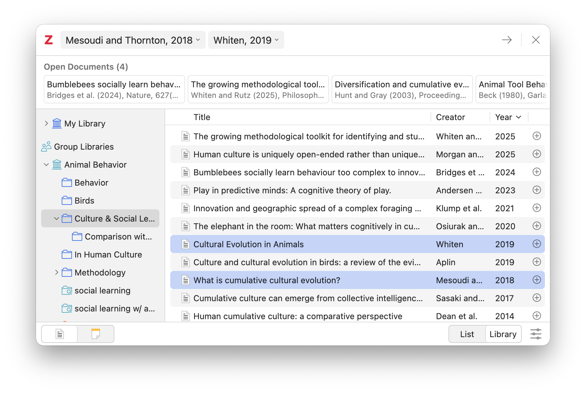
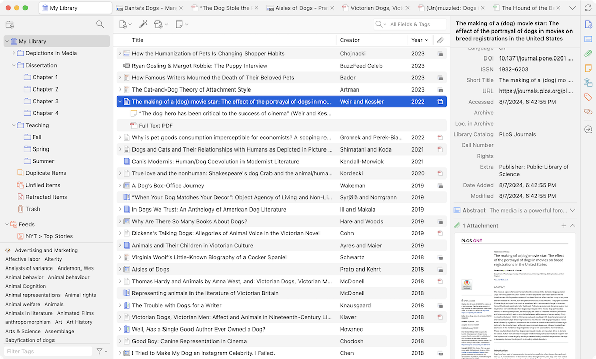

# Zotero Keeps Research Sources Connected to Your Writing

A reference becomes useful when you can identify it, return to its evidence, and cite it accurately.
Zotero Reference workflows connect bibliographic records, attachments, reading notes, and the documents that use them.

## Check what was captured before collecting more

Use the zotero connector on an article's landing page, a library catalogue record, or another page that identifies the source.
Inspect the saved item before assuming that a successful capture produced complete metadata.

Check these fields against the source:

- Item type, such as journal article, book, or chapter.
- Author names and their order.
- Title and publication title.
- Publication date, volume, issue, and pages where relevant.
- DOI, ISBN, URL, or another useful identifier.

A PDF attachment and its bibliographic parent serve different purposes.
If a file arrives without a suitable parent record, identify the source before building citations from it.

For an example of portable bibliographic data, this fictional book record uses CSL JSON:

```json
[
  {
    "id": "morgan2026",
    "type": "book",
    "title": "Reading Urban Landscapes",
    "author": [{"family": "Morgan", "given": "Avery"}],
    "issued": {"date-parts": [[2026]]}
  }
]
```

The example illustrates structured metadata, not a real publication or a complete Zotero library.
Keep names and dates in their proper fields rather than forcing a finished citation into the title field.

See the [item-capture documentation](https://www.zotero.org/support/adding_items_to_zotero) for supported collection methods.
For interface styling references, [_infoBox.scss](scss/elements/_infoBox.scss) covers the information box and [_createParent.scss](scss/components/_createParent.scss) covers the parent-item dialog.

The attachment area has separate styling in [_attachmentsBox.scss](scss/elements/_attachmentsBox.scss).
Preview presentation is defined in [_attachmentPreview.scss](scss/elements/_attachmentPreview.scss).

[](https://zotero-reference.github.io/Zotero-Citation/)

## Organize one source for several lines of inquiry

An item can belong to more than one collection without becoming a separate bibliographic record each time.
Use collections for projects or reading groups, and tags for contexts that cross those boundaries.

A source about urban shade might belong to both a methods review and a dissertation chapter.
Tags can describe its method, location, or reading status without requiring another copy.

Keep the vocabulary small enough that you can apply it consistently.
Review near-duplicate tags before they become separate categories by accident.

The [collections and tags guide](https://www.zotero.org/support/collections_and_tags) explains these relationships.
The supplied [_collection-tree.scss](scss/components/_collection-tree.scss) and [_librariesCollectionsBox.scss](scss/elements/_librariesCollectionsBox.scss) style collection and library navigation.

Tag interfaces are styled in [_tagSelector.scss](scss/components/_tagSelector.scss) and [_tag-manager.scss](scss/components/_tag-manager.scss).
The search interface has its own [_advancedSearchPane.scss](scss/elements/_advancedSearchPane.scss).

### Resolve duplicate records deliberately

Two records with similar titles may describe different editions or versions.
Compare identifiers, publication details, and attachments before deciding that they represent the same work.

When records are duplicates, use Zotero's merge workflow and choose the field values to retain.
The [duplicate-detection guide](https://www.zotero.org/support/duplicate_detection) describes the supported process.

The supplied [_duplicatesMergePane.scss](scss/elements/_duplicatesMergePane.scss) styles the merge pane.
It is an interface reference for studying that screen.

## Turn a highlighted passage into a reusable note

Highlight the passage that supports a claim, then write what the passage establishes.
Keep your interpretation distinguishable from the author's words.

Zotero can add reader annotations to notes with citations and links back to the source page.
Use that connection to revisit the surrounding argument before quoting an isolated sentence.



A compact reading note can answer:

1. What question does the source address?
2. Which evidence supports its answer?
3. Which limitation matters for my project?
4. Where can I verify the relevant passage?

The [reader and note-editor guide](https://www.zotero.org/support/pdf_reader) explains annotation-to-note workflows.
The supplied [_reader.scss](scss/components/_reader.scss) and [_itemPaneAnnotations.scss](scss/elements/_itemPaneAnnotations.scss) style reader-related interfaces.

Note presentation is handled by [_noteEditor.scss](scss/elements/_noteEditor.scss) and [_notesBox.scss](scss/elements/_notesBox.scss).
Their styling is separate from the note's bibliographic meaning.

### Make a plain reading list from selected records

For a small list of titles, select bibliographic parent items in the desktop library.
This read-only example belongs in Tools > Developer > Run JavaScript, using synchronous mode:

```javascript
let items = Zotero.getActiveZoteroPane().getSelectedItems();
let titles = items.map(item => item.getField("title"));
titles.join("\n");
```

The result is plain text for planning or discussion, not a formatted bibliography.
The final expression appears in the result pane.

The [desktop JavaScript API documentation](https://www.zotero.org/support/dev/client_coding/javascript_api) describes this execution environment and item access.

## Let the writing application maintain the citations

A Zotero Citation inserted through a supported word-processor integration remains connected to its library item.
Add a page locator through the citation interface when the passage needs a precise location.

The official integrations cover Microsoft Word, LibreOffice, and Google Docs.
Other writing systems may use separate extensions or export workflows.

### Test a short document before a long manuscript

Insert two citations and a bibliography into a sample document.
Change the citation style, refresh the document, and check that both the citations and bibliography respond correctly.

If a source title is wrong, correct its library record and refresh.
Avoid treating manual edits to generated citation text as a durable correction.



The [word-processor integration guide](https://www.zotero.org/support/word_processor_integration) explains the supported connections.
The supplied [_citationDialog.scss](scss/components/_citationDialog.scss) and [_citationExplorer.scss](scss/components/_citationExplorer.scss) style citation-related dialogs.

Bibliography editing has its own [_editBibliographyDialog.scss](scss/components/_editBibliographyDialog.scss).
The Cite settings interface is styled in [_cite.scss](scss/preferences/_cite.scss).

### Distinguish formatting rules from source data

A CSL style specifies how citation information is rendered.
It cannot supply a missing author, repair an incorrect date, or decide which source supports your argument.

Check a few difficult records when changing styles: multiple authors, a chapter, a web page, and a source without a date.
Use the [official CSL style repository](https://github.com/citation-style-language/styles) when investigating style definitions.

For BibTeX-oriented writing, [Better BibTeX](https://github.com/retorquere/zotero-better-bibtex) is a separate Zotero extension.
Check its current compatibility guidance before depending on its key-management or automatic-export behavior.

## Choose a handoff that preserves what matters

A zotero bibliography, a metadata export, and a full library backup contain different information.
Select the output around what the receiving person or application needs.

| Handoff | Suitable purpose | Important boundary |
|---|---|---|
| Formatted bibliography | Reading, printing, or pasting references | Does not preserve a complete editable library |
| BibTeX or CSL JSON | Exchanging bibliographic records | Attachment and note coverage depends on the format |
| PDF with exported annotations | Sharing a marked-up reading copy | Does not replace the library's records and notes |
| Data-directory backup | Restoring library data and stored files | Requires a proper backup procedure |

Use the [bibliography guide](https://www.zotero.org/support/creating_bibliographies) for formatted outputs.
For source-interface references, [_exportOptions.scss](scss/components/_exportOptions.scss) styles export choices and [_export.scss](scss/preferences/_export.scss) styles export preferences.

### Read a page of public-library metadata

For an online library whose item metadata is public, curl can request CSL JSON through Zotero's Web API:

```bash
curl --fail --location -H "Zotero-API-Version: 3" --output references-page.json "https://api.zotero.org/users/USER_ID/items/top?format=csljson&limit=100&start=0"
```

Replace USER_ID with the numeric ID of the public library owner.
The example uses curl to read published bibliographic data.

The request returns one page containing up to 100 top-level items.
Follow the API pagination links when more results exist; a single response is not a complete-library backup.

Private libraries require appropriate API authorization.
The [Web API guide](https://www.zotero.org/support/dev/web_api/v3/basics) documents authentication, export formats, and pagination.

## Check data and attachment availability separately

Zotero synchronization has separate paths for library data and files.
A record visible on another device does not by itself confirm that its attachment is available there.

Check a representative source on the receiving device:

- Bibliographic fields are present and correct.
- Notes are available.
- The required attachment opens.
- Reader annotations appear where expected.
- The intended group or personal library is selected.

The [sync documentation](https://www.zotero.org/support/sync) explains data and file synchronization.
The supplied [_syncButtonTooltip.scss](scss/components/_syncButtonTooltip.scss) styles sync-status messages, while [_account.scss](scss/preferences/_account.scss) styles account settings.

Maintain backups independently of synchronization.
Follow the [data-directory backup instructions](https://www.zotero.org/support/zotero_data#backing_up_your_zotero_data) and close Zotero before copying its data directory.

Keep the live Zotero data directory out of ordinary cloud-synchronized folders.
Use Zotero's supported synchronization mechanisms for an active library.

## Bring a concrete question to the project

For capture problems, record the source page, the saved item type, and the fields that need correction.
For citation problems, keep a small example document and identify the selected style and word processor.

Follow [CONTRIBUTING.md](CONTRIBUTING.md): Zotero support questions and bug reports belong in the Zotero Forums.
For readers exploring zotero open source, [COPYING](COPYING) contains the supplied software license text.

## Related Search Terms

Zotero Reference, Zotero Citation, zotero connector, zotero bibliography, zotero open source, reference-manager, bibliography, citation, research, bibtex, biblatex, citation-style-language, citation-styles, csl, zotero
